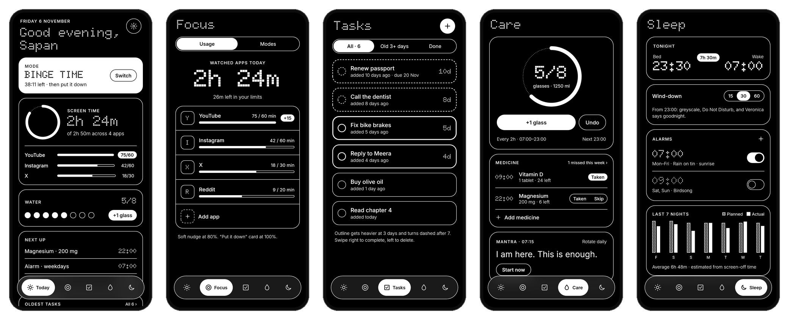
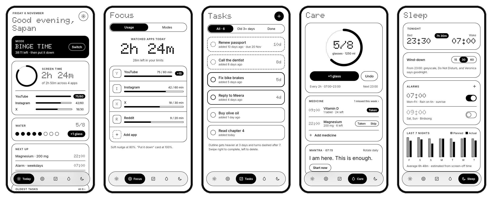
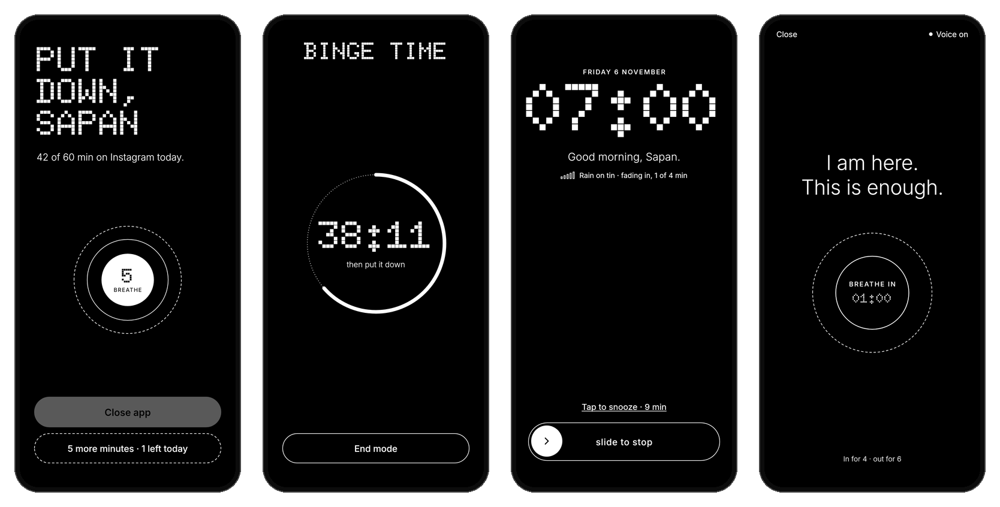
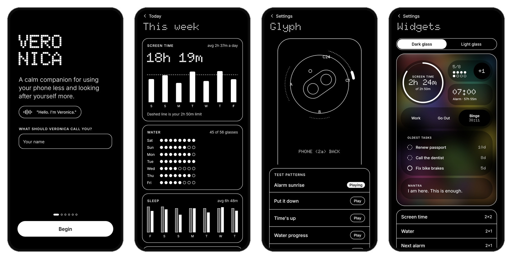
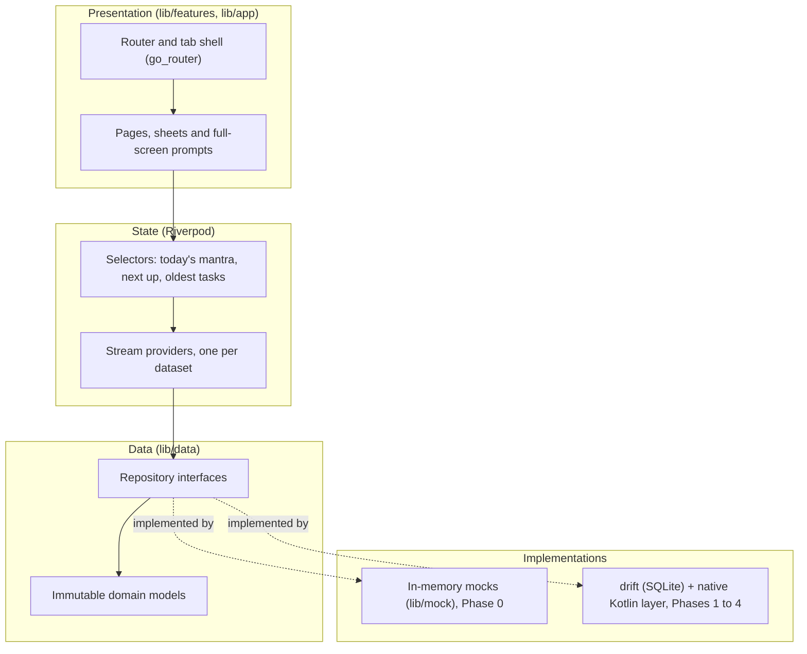

<div align="center">

# Veronica

**A calm Android companion for using your phone less and looking after yourself more.**


</div>

<p align="center">
  
</p>

---

## Why Veronica

Most phones are designed to be picked up. Veronica is designed to help you put yours down.

It watches only the apps **you** choose, notices when time in them runs past the limit you set, and asks you, gently, to stop. Alongside that it keeps the small routines that make a day go well in one quiet place: drinking water, taking medicine, a sleep schedule with a calm alarm, a daily mantra, and a to-do list that shows how long each task has been waiting.

It is built first for the **Nothing Phone (2a)**, where the Glyph lights on the back become a second, glanceable screen: a sunrise for the alarm, a slow fill for screen time, a breathing glow for the mantra.

### Principles

| Principle | What it means in practice |
| --- | --- |
| **Calm, not guilt** | Nudges start soft and escalate slowly. No streaks, no shaming, no red. Even a hard block keeps a logged emergency exit. |
| **You choose what is watched** | Only the apps you pick are tracked. Nothing else on the phone is read. |
| **Offline and private** | No account, no server, no analytics. All data stays on the phone. The only network request is a one-time download of the offline voice model. |
| **Glanceable** | Anything that can be said with a Glyph pattern instead of lighting the screen should be. |
| **Distraction-free by design** | Pure black and white, dot-matrix type, no badges or colour competing for attention. Follows the system light or dark mode. |

Veronica is a personal, sideloaded app. It is not distributed through the Play Store, which lets it use ADB-granted permissions (greyscale, Glyph control) that a store app could not.

---

## Features

| Area | What it does |
| --- | --- |
| **App usage** | Daily limit per watched app; a soft nudge at 50, 80 or 90 %; a full-screen *Put it down* card at 100 % with a five-second breath before *Close app*; up to two *5 more minutes* per day; optional hard block with a logged emergency override. |
| **Modes** | *Work*, *Go Out* and *Binge Time* presets, plus your own. Each bundles greyscale, Do Not Disturb, blocked apps, water reminders, a timer and a Glyph pattern; custom modes can also dim the screen, change the ringer, hide notifications and switch to a black wallpaper. Everything is restored when the mode ends. |
| **Tasks with age** | Every task shows how long it has waited. The outline grows heavier at three days and turns dashed after seven, so old tasks stand out without colour. |
| **Water** | A daily goal in glasses or millilitres, reminders spread across your waking hours, one-tap logging. |
| **Medicine** | Optional. Doses with *Taken / Skip / Snooze*, missed-dose history and refill reminders. |
| **Sleep and alarm** | Bedtime and wake targets, a wind-down that turns on greyscale and Do Not Disturb, and a calm alarm that fades in your own sounds while the Glyph lights rise like a sunrise. |
| **Daily mantra** | A line of your choosing at a set time, with a one-minute breathing session (in for four, out for six). |
| **Voice** | Veronica can speak key moments in a soft, fully offline voice (Kokoro-82M via sherpa-onnx), falling back to system speech. |
| **Glyph** | Seven patterns for the Phone (2a): alarm sunrise, put it down, time's up, water progress, medicine due, mantra breathing and focus countdown. |
| **Home widgets** | Six widgets in Nothing's grid style: screen time, water, mode switch, oldest tasks, next alarm and mantra. |

---

## Screens

**Light mode.** Veronica follows the system theme. Light mode is the exact inverse of dark: black ink on white.

<p align="center">
  
</p>

**Full-screen prompts.** These open over any app, which is also when Veronica is allowed to drive the Glyph lights: *Put it down*, an active *Work* mode with its Pomodoro ring, the calm alarm, and the mantra session.

<p align="center">
  
</p>

**Onboarding, weekly summary, Glyph test patterns and widget previews.**

<p align="center">
  
</p>

The full design, all 37 screens, lives in [`design/`](design/). The spec the code follows is [`design/DESIGN.md`](design/DESIGN.md).

---

## Architecture

Veronica is a Flutter app (Cupertino widgets only, no Material) with a thin native Kotlin layer for the parts of Android that Flutter cannot reach. The code is arranged in four layers, and each depends only on the one below it.



**Presentation.** Every screen is a widget under `lib/features/<area>/` that watches Riverpod providers and calls repository methods; no screen holds data of its own. Screens are built from a small design system in `lib/core/` (cards, pills, switches, wheels, rings, charts, glass) that draws everything in the current *ink*. Inversion, light mode and dark mode therefore need no special cases: a white card simply flips the ink to black for its contents.

**State.** Providers are written with `riverpod_generator`. Each dataset is exposed as a stream, so a change made anywhere (logging a glass of water from a widget, say) updates every screen showing it. Derived values that several screens need, such as today's mantra or the *Next up* list, are computed once in `lib/features/selectors.dart`.

**Data.** `lib/data/repositories/repositories.dart` defines one interface per area: tasks, usage, water, medicine, modes, sleep, mantras, settings, permissions and profile. The models in `lib/data/models/` mirror the planned database tables, so a real implementation can replace a mock without the UI changing.

**One switch between mock and real.** `lib/data/providers.dart` is the only file that decides which implementation backs each repository. In Phase 0 all of them are in-memory mocks anchored to a fixed moment (Fri 6 Nov 2026, 21:04), so every screen can be compared with the design. As each phase lands, its repositories switch to real ones and [`mockdata.md`](mockdata.md) records the change.

**Native layer (planned).** A foreground service and an accessibility service watch app usage and launch the full-screen prompts; platform channels expose Do Not Disturb, greyscale, exact alarms and boot restore. The Glyph lights go through the official Glyph Developer Kit, voice through sherpa-onnx, and home widgets through `home_widget` with native layouts.

### Enforced rules

These are checked by tests on every run, not left to convention:

- **Two colours.** Colours may only be created in `lib/core/theme/v_colors.dart`, and importing Material fails the build. The only exception, the stand-in wallpaper behind the widget previews, is named there and documented.
- **Every screen opens.** A smoke test opens all 32 routes on a phone-sized view, in light and dark mode, with the real fonts loaded, and fails on any exception or layout overflow.
- **Onboarding works end to end**, and back navigation behaves as designed: back on a tab goes to Today, and back on Today asks once before exiting.
- **The shown version matches `pubspec.yaml`.**

---

## Project structure

```text
veronica/
├── lib/
│   ├── main.dart                 Entry point: fonts, edge-to-edge, ProviderScope
│   ├── app/                      App shell
│   │   ├── app.dart              CupertinoApp, system light/dark palette
│   │   ├── router.dart           Every route (go_router), transitions
│   │   ├── routes.dart           Route paths in one place
│   │   ├── shell.dart            Tab shell, back-to-Today and exit prompt
│   │   └── version.dart          Version shown in Settings
│   ├── core/                     Shared, feature-agnostic code
│   │   ├── theme/                Colours, palette, type scale, tokens, Cupertino theme
│   │   ├── icons/                Line icons drawn from SVG paths
│   │   ├── widgets/              Design system: cards, buttons, controls, charts, glass, wheels
│   │   ├── clock.dart            Injectable clock (mock or system time)
│   │   └── format.dart           Durations, ages, dates, greetings
│   ├── data/
│   │   ├── models/               Immutable domain models
│   │   ├── repositories/         Repository interfaces
│   │   └── providers.dart        The mock/real switch and the stream providers
│   ├── mock/                     In-memory mock repositories and sample data
│   └── features/                 One folder per area
│       ├── today/                Today tab, weekly summary, mode switcher
│       ├── focus/                Usage, modes, app detail, mode editor, active mode
│       ├── tasks/                Task list, add sheet, task detail
│       ├── care/                 Water, medicine, mantra library
│       ├── sleep/                Schedule, alarms, sound library
│       ├── settings/             Settings pages, Glyph patterns, widget previews
│       ├── onboarding/           Six-step first run
│       ├── prompts/              Full-screen prompts over other apps
│       └── selectors.dart        Values derived from several datasets
├── test/                         Unit, widget and smoke tests
├── android/                      Android host (native Kotlin layer arrives in Phase 1)
├── assets/                       Bundled fonts (OFL) and app icon sources
├── design/                       Design export and the Flutter design spec
├── docs/                         Product plan and README screenshots
└── mockdata.md                   Registry of every mock dataset
```

---

## Getting started

### Requirements

- Flutter 3.47 or later (Dart 3.13)
- Android SDK 36 and JDK 17
- A Nothing Phone (2a) for the Glyph features; any recent Android phone runs the rest

### Build and run

```sh
flutter pub get
dart run build_runner build        # Riverpod code generation
flutter analyze
flutter test
flutter run                        # with the phone connected over USB debugging
```

### One-time phone setup

Onboarding asks for usage access, accessibility, display over other apps, Do Not Disturb, notifications, exact alarms and unrestricted battery. Greyscale additionally needs one ADB grant:

```sh
adb shell pm grant com.isg32.veronica android.permission.WRITE_SECURE_SETTINGS
```

On phones older than Android 16, Glyph control may also need debug mode, which switches itself off after 48 hours:

```sh
adb shell settings put global nt_glyph_interface_debug_enable 1
```

Re-run both commands after a factory reset.

### Exploring Phase 0

Phase 0 runs entirely on sample data, which resets on every launch. In debug builds, **Settings → Preview prompts** opens each full-screen prompt, and **Settings → Data & About → Reset all data** replays onboarding.

---

## Development

- **Commits.** History is linear on `main` and follows [Conventional Commits](https://www.conventionalcommits.org/) (`feat(today): …`, `fix(tasks): …`, `docs: …`). Each commit must pass `flutter analyze` and `flutter test`.
- **Versioning.** Each completed phase bumps `version:` in `pubspec.yaml` and `lib/app/version.dart` in a `chore(release): …` commit: 0.1.0 after Phase 0, then 0.2.0, 0.3.0 and 0.4.0, and 1.0.0 after Phase 4. The build number after `+` goes up by one on every bump. See [Versioning](docs/PLAN.md#roadmap).
- **Mock data.** Every fake dataset is listed in [`mockdata.md`](mockdata.md). When a feature goes live, its row flips from *Mock* to *Real*.
- **App icon.** Sources are in `assets/icon/`. Run `dart run flutter_launcher_icons` after changing them.

---

## Roadmap

| Phase | Scope | Status |
| --- | --- | --- |
| **0 · UI on mocks** | Every page, prompt and widget layout from the design, on sample data | In progress: all in-app screens built, native home widgets remaining |
| **1 · Usage watcher** | Native watcher, accessibility detection, limits, nudges, prompts over other apps | Planned |
| **2 · Modes and phone control** | Modes and schedules, quick-settings tile, Do Not Disturb, greyscale, brightness, volume, wallpaper | Planned |
| **3 · Care, tasks and sleep** | On-device storage, notifications, wind-down, calm alarm with imported sounds | Planned |
| **4 · Glyph, voice and widgets** | Glyph patterns, offline voice, the six home widgets | Planned |

The full plan, including each phase's definition of done, is in [`docs/PLAN.md`](docs/PLAN.md).

---

## License

Copyright (C) 2026 Sapan Gajjar

Veronica is free software: you can redistribute it and/or modify it under the terms of the [GNU General Public License v3.0](LICENSE) as published by the Free Software Foundation. It is distributed in the hope that it will be useful, but WITHOUT ANY WARRANTY; without even the implied warranty of MERCHANTABILITY or FITNESS FOR A PARTICULAR PURPOSE. See the [LICENSE](LICENSE) for details.

Bundled third-party assets keep their own licences: Doto and Inter are under the SIL Open Font License ([`assets/fonts/`](assets/fonts/)), and `design/support.js` is the Claude Design canvas runtime, included only to view the design export.
